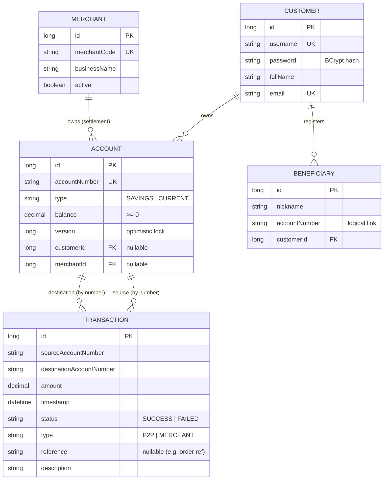
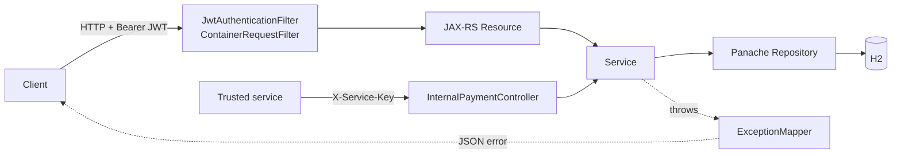
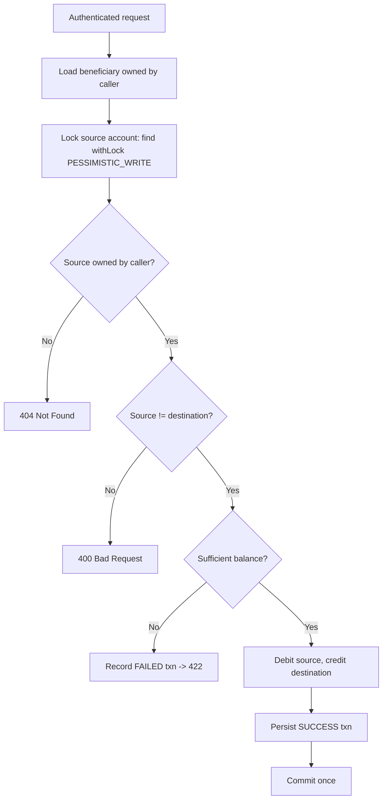

# Fund Transfer Service (Quarkus edition)

A Quarkus REST backend implementing a retail-banking fund-transfer use case — customer login,
account details, beneficiary CRUD, atomic fund transfer, transaction history —
**plus** an internal, service-to-service **merchant payment** API (the HungerBox
integration). This is the complete application; it matches the shipped code.

---

## Table of contents

1. [What it does](#1-what-it-does)
2. [Technology stack](#2-technology-stack)
3. [Engineering choices](#3-engineering-choices)
4. [Java 8 & 17 feature evidence](#4-java-8--17-feature-evidence)
5. [Assumptions made from the brief](#5-assumptions-made-from-the-brief)
6. [Use case coverage](#6-use-case-coverage)
7. [How the "Expected Output" rubric is met](#7-how-the-expected-output-rubric-is-met)
8. [Design notes](#8-design-notes)
9. [Domain model](#9-domain-model)
10. [Architecture & request flow](#10-architecture--request-flow)
11. [Transfer flow (atomicity & concurrency)](#11-transfer-flow-atomicity--concurrency)
12. [Security model](#12-security-model)
13. [API contract](#13-api-contract)
14. [Error handling](#14-error-handling)
15. [Project structure](#15-project-structure)
16. [Build & run](#16-build--run)
17. [Seeded demo data](#17-seeded-demo-data)
18. [End-to-end demo](#18-end-to-end-demo)
19. [Testing](#19-testing)
20. [Database schema](#20-database-schema)
21. [Configuration reference](#21-configuration-reference)
22. [Production follow-ups](#22-production-follow-ups)
23. [Further reading](#23-further-reading)

---

## 1. What it does

A logged-in customer can **log in** (JWT), **view their accounts**, **manage
beneficiaries** (full CRUD), **transfer money** to a saved beneficiary (atomic,
balance-checked, concurrency-safe), and **review transaction history** by date
range or month. Everything above is scoped to the authenticated customer.

In addition, the service exposes an **internal merchant-payment API** for trusted
services (not end users): given a customer account, a **merchant** settlement
account and an amount, it debits the customer and credits the merchant. Money
movement is therefore of two kinds — **P2P** (beneficiary-scoped, customer-facing)
and **MERCHANT** (by account number, service-to-service).

---

## 2. Technology stack

| Concern              | Choice |
|----------------------|--------|
| Language             | Java 17 |
| Framework            | Quarkus 3.15 (Quarkus REST, Hibernate ORM Panache, Hibernate Validator) |
| Persistence          | Hibernate ORM with Panache |
| Database             | H2 in-memory (drop-and-create) |
| Auth                 | Stateless JWT (`jjwt` 0.12), BCrypt (`at.favre.lib:bcrypt`) |
| Service-to-service   | Shared service key (`X-Service-Key` header) on `/internal/**` |
| Build                | Maven (`quarkus-maven-plugin`) |
| Testing              | JUnit 5 (`@QuarkusTest`), REST Assured |

Zero-setup in-memory DB; swapping to PostgreSQL is a dependency + config change
(see [§20](#20-database-schema)).

---

## 3. Engineering choices

- **Layered architecture** — `resource → service → repository`; no business logic
  in resources (JAX-RS).
- **DTOs on the wire, never entities** — every request/response is a `record`.
- **Atomic transfers** — the transfer service method is
  `@Transactional(rollbackOn = Exception.class)`. The merchant-payment service
  uses the same atomic pattern.
- **Concurrency safety** — the source account is read under a `PESSIMISTIC_WRITE`
  lock and the `Account` entity carries a JPA `@Version` column.
- **Merchant payments are additive** — a `Merchant` owns an `Account` in the same
  `accounts` table; the internal endpoint moves money **by account number** and so
  needs no beneficiary. The P2P code is untouched.
- **Authorization scoping** — every account/beneficiary lookup is filtered by the
  authenticated username at the repository level.
- **Audit trail** — an insufficient-funds transfer or merchant payment is
  persisted as a `FAILED` transaction before the request is rejected.
- **Consistent errors** — JAX-RS `ExceptionMapper`s produce one stable JSON error
  shape with an application `code` and the right HTTP status.
- **Bean Validation** at the resource edge with `@Valid`.

---

## 4. Java 8 & 17 feature evidence

| Generation | Feature | Where |
|------------|---------|-------|
| Java 8 | Streams + method references | entity → DTO mapping in every service |
| Java 8 | `Optional` chaining | ownership checks |
| Java 8 | Lambdas | JWT claim resolver, factories |
| Java 8 | Date/Time API | `LocalDate`, `LocalDateTime`, `YearMonth` |
| Java 17 | `record` | every DTO, `UsernamePrincipal` |
| Java 17 | Text blocks | the Panache history query |
| Java 17 | `Stream.toList()` | throughout |
| Java 17 | `var` | local inference where it aids readability |

Balance mutation and locking are kept explicit and imperative on purpose.

---

## 5. Assumptions made from the brief

1. Customers already exist (seeded; no self-registration).
2. Same-bank transfers only (the "logical link"); merchants are seeded too.
3. A customer can own multiple accounts.
4. Beneficiary uniqueness is per `(customer, accountNumber)`; no self-beneficiary,
   and a merchant account cannot be added as a beneficiary.
5. Amounts are positive `BigDecimal` (scale 2); single-currency.
6. Failed transfers/payments are recorded as `FAILED`; validation failures are
   rejected first.
7. Transactions are immutable once written; each carries a `type` (`P2P`/`MERCHANT`)
   and an optional external `reference`.
8. Server-clock timestamps; inclusive date/month bounds.
9. In-memory DB resets to the seeded state on every restart.

---

## 6. Use case coverage

| Requirement                                 | Implementation |
|---------------------------------------------|----------------|
| Register customer *(assumed to exist)*      | Customers seeded on startup (`DataSeeder`) |
| Login → success / failure                   | `POST /api/auth/login` → JWT; 401 on bad credentials |
| Account details                             | `GET /api/accounts`, `GET /api/accounts/{accountNumber}` |
| Beneficiary CRUD                            | `GET/POST/PUT/DELETE /api/beneficiaries` |
| Fund transfer                               | `POST /api/transfers` (atomic, balance-checked, concurrency-safe) |
| Transaction history by date range / month   | `GET /api/transactions?from=&to=` or `?month=YYYY-MM` |
| Merchant payment (service-to-service)       | `POST /internal/payments/merchant` (`X-Service-Key`) |

---

## 7. How the "Expected Output" rubric is met

- **Proper DB model** — five entities (`Customer`, `Account`, `Beneficiary`,
  `Transaction`, `Merchant`) with correct relationships, unique constraints and
  indexes (incl. a `reference` index on transactions).
- **Proper REST guidelines** — resource URLs, correct verbs, correct status codes
  (200/201/204/400/401/404/422), DTOs on the wire, a consistent JSON error shape.
- **Functional programming approach** — records, Streams + method references,
  `Optional` chaining, text blocks.
- **Clean, layered code** — `resource → service → repository`, CDI constructor
  injection, single responsibility, thin resources.
- **Automated test** — a `@QuarkusTest` + REST Assured end-to-end test (§19). A
  JaCoCo coverage gate can be added via `quarkus-jacoco`.

---

## 8. Design notes

- **Atomicity via a single transaction.** `TransferServiceImpl.transfer` (P2P) and
  `MerchantPaymentServiceImpl.pay` (merchant) are each `@Transactional`, so the
  debit, the credit and the `Transaction` insert are one unit of work; any failure
  before commit rolls back all three.
- **Two layers of concurrency protection.** The source account is loaded with a
  `PESSIMISTIC_WRITE` lock so concurrent movements on the same account serialise;
  the `Account` also carries a JPA `@Version` as a second line of defence.
- **Append-only ledger keyed by account number.** `Transaction` stores the source
  and destination *account numbers* (strings), not FKs, and records a `type`
  (`P2P`/`MERCHANT`) and an optional external `reference`.
- **Merchant vs beneficiary.** A **beneficiary** is a payee a customer saved, and
  `/api/transfers` only pays a saved beneficiary. A **merchant** is a business with
  its own settlement account and is **not** a beneficiary of anyone, so merchant
  payments use a separate internal endpoint that moves money **by account number**.
  Merchants and their accounts (MER5001–MER5010, balance 0) are created on startup
  by `MerchantDataSeeder`.
- **Failed attempts are still recorded.** An insufficient-funds transfer or
  merchant payment writes a `FAILED` transaction before returning **422** (and,
  being inside the same rolled-back transaction, that row is rolled back with the
  throw — behaviour preserved exactly from the Spring original). Pure validation
  errors are rejected at the edge and not persisted.
- **Idempotency for merchant payments (scaffolded).** The infrastructure is in
  place — a `reference` column + index and `findFirstByReferenceAndStatus` — but
  the idempotency guard in `MerchantPaymentServiceImpl.pay` is **currently
  commented out** (as in the original), so a repeated `reference` is not yet
  short-circuited. Uncomment the guard to make a retry return the original result
  instead of charging again.
- **`BigDecimal` for money.** All balances and amounts use `BigDecimal` scale 2 —
  never `double`.
- **Centralized error handling.** Three JAX-RS `ExceptionMapper`s own the mapping
  from exception → status + JSON body, keeping resources thin.
- **Stateless JWT security.** No server session; the token's subject is the
  username. Internal endpoints are guarded separately by a shared service key.

---

## 9. Domain model



An `Account` is owned by **either** a `Customer` (P2P) **or** a `Merchant`
(settlement) — exactly one FK is set.

---

## 10. Architecture & request flow



The JWT filter leaves `/internal/**` public; the internal resource authorises
itself with the shared `X-Service-Key`.

---

## 11. Transfer flow (atomicity & concurrency)



The merchant-payment flow is the same shape: lock the customer source account,
resolve the merchant account by number, check funds, debit/credit, persist a
`MERCHANT` transaction.

---

## 12. Security model

- **Login** verifies the BCrypt password directly in `AuthServiceImpl` (no
  `AuthenticationManager`) and returns a JWT whose subject is the username.
- **Stateless** — protected requests carry `Authorization: Bearer <token>`.
- **Filter** — one `ContainerRequestFilter` validates the token, installs a JAX-RS
  `SecurityContext`, and enforces the path rules. Public prefixes: `/api/auth`,
  `/internal`, `/q`.
- **Internal endpoints** — guarded by the `X-Service-Key` header, checked in
  `InternalPaymentResource` against `app.internal.api-key`.
- **Unauthenticated** `/api/**` → bare **401**; bad credentials → **401** with the
  error body.

---

## 13. API contract

Base URL: `http://localhost:8080`. All `/api/**` paths except `/api/auth/**`
require a Bearer token. `/internal/**` requires the `X-Service-Key` header instead.

| Method | Path | Purpose | Success | Body / Params |
|--------|------|---------|---------|---------------|
| POST   | `/api/auth/login` | Log in, get JWT | 200 | `{username, password}` |
| GET    | `/api/accounts` | List my accounts | 200 | — |
| GET    | `/api/accounts/{accountNumber}` | Get one owned account | 200 | — |
| GET    | `/api/beneficiaries` | List my beneficiaries | 200 | — |
| GET    | `/api/beneficiaries/{id}` | Get one beneficiary | 200 | — |
| POST   | `/api/beneficiaries` | Add a beneficiary | 201 | `{nickname, accountNumber}` |
| PUT    | `/api/beneficiaries/{id}` | Update a beneficiary | 200 | `{nickname, accountNumber}` |
| DELETE | `/api/beneficiaries/{id}` | Delete a beneficiary | 204 | — |
| POST   | `/api/transfers` | Transfer funds atomically (P2P) | 201 | `{sourceAccountNumber, beneficiaryId, amount, description?}` |
| GET    | `/api/transactions` | History (paged; `?month=` or `?from=&to=`) | 200 | `?page=&size=` |
| POST   | `/internal/payments/merchant` | Merchant payment (service-to-service) | 200 | header `X-Service-Key`; `{sourceAccountNumber, merchantAccountNumber, amount, reference}` |

### Example: P2P transfer

```http
POST /api/transfers
Authorization: Bearer <token>
Content-Type: application/json

{ "sourceAccountNumber": "ACC1001", "beneficiaryId": 1, "amount": 300.00, "description": "rent" }
```
```json
{ "transactionId": 1, "sourceAccountNumber": "ACC1001", "destinationAccountNumber": "ACC2001",
  "amount": 300.00, "status": "SUCCESS", "timestamp": "2026-09-21T10:42:11", "sourceBalanceAfter": 4700.00 }
```

### Example: merchant payment

```http
POST /internal/payments/merchant
X-Service-Key: hungerbox-to-fundtransfer-shared-key-2026
Content-Type: application/json

{ "sourceAccountNumber": "ACC1001", "merchantAccountNumber": "MER5001", "amount": 126.00, "reference": "ORD-ABCD1234" }
```
```json
{ "transactionId": 42, "status": "SUCCESS", "sourceBalanceAfter": 4874.00, "reference": "ORD-ABCD1234" }
```

---

## 14. Error handling

```json
{ "timestamp": "2026-09-21T10:45:00", "status": 422, "error": "Unprocessable Entity",
  "code": "FT-TXN-002", "message": "Insufficient balance in account ACC1001", "details": [] }
```

| Situation | Status | Example code |
|-----------|--------|--------------|
| Validation failure | 400 | `FT-VAL-001` (`details` lists each field) |
| Business rule (duplicate/own/merchant/non-existent beneficiary, self-transfer) | 400 | `FT-BEN-00x`, `FT-TXN-001` |
| Bad credentials | 401 | `FT-AUTH-001` (missing/invalid token → bare 401) |
| Missing/invalid service key | 401 | `FT-MER-002` |
| Not found / not owned | 404 | `FT-ACC-001`, `FT-MER-001` |
| Insufficient funds | 422 | `FT-TXN-002` |

> **Behavioural note:** the insufficient-funds path persists a `FAILED` transaction
> and then throws, so the row rolls back with the transaction — as in the original.

---

## 15. Project structure

```
com.lbg.fundtransfer
├── config
│   ├── DataSeeder.java               @Observes StartupEvent, @UnlessBuildProfile("test")
│   └── MerchantDataSeeder.java       seeds merchants + MER5001..MER5010
├── controller                        Auth, Account, Beneficiary, Transfer, Transaction, InternalPayment (JAX-RS)
├── domain                            Customer, Account, Beneficiary, Transaction, Merchant, enums, ErrorCode
├── dto                               request/response records + ErrorResponse, PageResponse
├── exception                         custom exceptions + ApiExceptionMapper, ValidationExceptionMapper, GenericExceptionMapper
├── repository                        Panache repositories (incl. MerchantRepository)
├── security                          JwtService, JwtAuthenticationFilter, PasswordEncoder, BcryptPasswordEncoder, UsernamePrincipal
└── service (+ impl)                  Auth, Account, Beneficiary, Transfer, TransactionHistory, MerchantPayment

src/main/resources
├── application.properties
└── V1__create_schema.sql             illustrative schema (see §20)

src/test/java/com/lbg/fundtransfer
└── FundTransferIntegrationTest.java  @QuarkusTest + REST Assured end-to-end flow
```

No application main class — Quarkus provides the entry point.

---

## 16. Build & run

```bash
mvn quarkus:dev                               # live reload + Dev UI at /q/dev
mvn test                                      # run tests
mvn package && java -jar target/quarkus-app/quarkus-run.jar
mvn package -Dnative                          # optional native image (GraalVM/Mandrel)
#   API: http://localhost:8080
```

No H2 web console; use the Dev UI at `/q/dev` in dev mode.

---

## 17. Seeded demo data

20 customers (passwords: `alice` → `password1`, `bob` → `password2`, everyone else
→ `password123`) plus 10 merchants with settlement accounts **MER5001–MER5010**
(balance 0). Bob is seeded before Alice, so Alice's beneficiary is id `1`. The
full customer table is in `README_v2.md` §14; key fixtures:

- Successful P2P: `alice` ACC1001 → beneficiary 1 (Bob).
- Insufficient funds: `dave` ACC4001 (balance 50) → Alice, amount 500.
- Zero balance: `karl` ACC11001.
- Merchant payment: any customer account → `MER5001`..`MER5010`.

---

## 18. End-to-end demo

```bash
BASE=http://localhost:8080

# 1) Login -> capture JWT
TOKEN=$(curl -s -X POST $BASE/api/auth/login -H 'Content-Type: application/json' \
  -d '{"username":"alice","password":"password1"}' | sed -E 's/.*"token":"([^"]+)".*/\1/')
AUTH="Authorization: Bearer $TOKEN"

# 2) View accounts
curl -s $BASE/api/accounts -H "$AUTH"

# 3) List beneficiaries (Bob is pre-seeded as id 1)
curl -s $BASE/api/beneficiaries -H "$AUTH"

# 4) P2P transfer 300 from ACC1001 to beneficiary 1
curl -s -X POST $BASE/api/transfers -H "$AUTH" -H 'Content-Type: application/json' \
  -d '{"sourceAccountNumber":"ACC1001","beneficiaryId":1,"amount":300.00,"description":"rent"}'

# 5) History (all / range / month)
curl -s "$BASE/api/transactions" -H "$AUTH"
curl -s "$BASE/api/transactions?from=2026-01-01&to=2026-12-31" -H "$AUTH"
curl -s "$BASE/api/transactions?month=2026-09" -H "$AUTH"

# 6) MERCHANT payment (service-to-service; no JWT, no beneficiary) — credits MER5001
curl -s -X POST $BASE/internal/payments/merchant \
  -H 'Content-Type: application/json' \
  -H 'X-Service-Key: hungerbox-to-fundtransfer-shared-key-2026' \
  -d '{"sourceAccountNumber":"ACC1001","merchantAccountNumber":"MER5001","amount":100.00,"reference":"DEMO-001"}'
```

The bundled Postman collections under `postman/` run these flows (incl. the
merchant collection and negative cases) unchanged.

---

## 19. Testing

A `@QuarkusTest` + REST Assured integration test (`FundTransferIntegrationTest`)
walks the real HTTP stack: login, unauthorized access, account scoping, a P2P
transfer, the insufficient-funds `422`, and the internal merchant payment (with
and without the service key). Seeders are off under the `test` profile, so the
test persists its own fixtures via the repositories in a `QuarkusTransaction`.

```bash
mvn test
```

> To enforce a line-coverage threshold like the Spring original's 80% gate, add
> the `quarkus-jacoco` extension and a `jacoco-maven-plugin` `check` rule in the
> `verify` phase.

---

## 20. Database schema

H2 with Hibernate auto-DDL (`drop-and-create`) generates tables from the entities.
`src/main/resources/V1__create_schema.sql` is an illustrative Flyway/PostgreSQL
schema. To use real migrations: add `quarkus-flyway`, set
`quarkus.hibernate-orm.database.generation=validate`, and apply `V1` against a
persistent DB.

---

## 21. Configuration reference

| Property | Value | Meaning |
|----------|-------|---------|
| `quarkus.datasource.jdbc.url` | `jdbc:h2:mem:fundtransfer` | in-memory H2 |
| `quarkus.hibernate-orm.database.generation` | `drop-and-create` | schema from entities |
| `app.security.jwt.secret` | *(base64)* | HMAC signing key (override via `APP_SECURITY_JWT_SECRET`) |
| `app.security.jwt.expiration-minutes` | `60` | token lifetime |
| `app.internal.api-key` | *(shared key)* | expected `X-Service-Key` on `/internal/**` |

Any property can be overridden by an environment variable via MicroProfile Config.

---

## 22. Production follow-ups

- Externalize the JWT secret and the internal service key to a secrets manager;
  add refresh tokens/MFA; rotate keys.
- Turn on merchant idempotency (uncomment the guard) and add request idempotency
  keys for P2P too.
- Replace same-bank beneficiary lookup with an external payment-rail adaptor; add
  currency handling.
- PostgreSQL + Flyway; Testcontainers (Quarkus Dev Services) in CI.
- Add the `quarkus-jacoco` coverage gate, rate limiting, an audit/event outbox,
  and `quarkus-smallrye-openapi` for Swagger UI.
- Consider a native image for faster startup and lower memory.

---

## 23. Further reading

Longer-form reference material lives in [`docs/`](docs/):

| Document | What's in it |
| --- | --- |
| [Spring Boot → Quarkus mapping](docs/SPRING_TO_QUARKUS.md) | Concern-by-concern table of what each Spring Boot construct became in Quarkus, plus the behavioural differences that survived the port. |
| [Code walkthrough](docs/CODE_WALKTHROUGH.md) | Guided tour of the packages and the request path through them. |
| [Changes for HungerBox](docs/FUND_TRANSFER_CHANGES.md) | The merchant-payment additions this service exposes to the HungerBox ordering service. |
